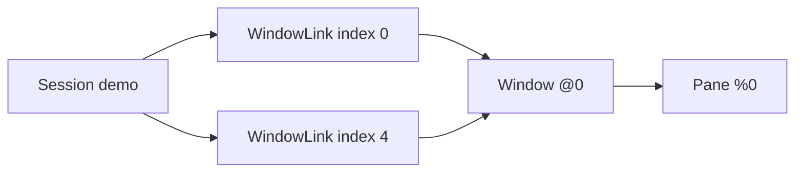

# Capture and navigate a tmux server

Use [`withServer`](../src/LibTmux/Server.hs) to adopt an existing endpoint and
[`capture`](../src/LibTmux/Server.hs) to obtain a detached
[`Snapshot`](../src/LibTmux/Snapshot.hs). The complete program in the
[README](../README.md) filters ordinary pane records, traverses relationships
and prints its result after the handle closes. Its
[source](../examples/capture-graph/Main.hs) and
[fixture runner](../examples/capture-graph/run.py) are checked from the source
archive, with the expected output asserted and owned process exits observed.

From a provisioned checkout, run the owned fixture:

```console
$ python3 examples/capture-graph/run.py
```

To inspect your own running server, pass its socket and executable paths to
the Haskell program. Replace both arguments with paths on your machine:

```console
$ cabal run --verbose=0 capture-graph -- /tmp/tmux-1000/default /usr/bin/tmux
```

The library requires a trusted absolute socket path and a writable pin
directory on that socket's filesystem. The default pin directory is the
socket's parent. [Installation](installation.md#native-backend-host-requirements)
describes the Linux host requirements.

## Physical entities and appearances

A session links windows at numeric indices. The same physical window can
appear at two indices in one session or in several sessions. A pane belongs
to its physical window, while a pane occurrence retains the window-link
context:



`windows` and `panes` return each physical entity once. `windowLinks` and
`paneOccurrences` retain both appearances in this fixture. Lists use numeric
ID order; links use session ID and window index; occurrences use link and
pane index. Indexed lookups avoid rescanning those lists.

References compare targeting identity within one Server generation. A lookup
returns the observation from the supplied snapshot, including a later capture
from that same Server. Independent Server scopes have distinct generations.
Resolving a native ID with `lookupPaneId` deliberately selects its observation
in the supplied snapshot; it does not restore an earlier targeting guarantee.

Record updates create local values. They do not update the snapshot's indexes,
validate a caller-edited graph or send a tmux command. Use
`dimensionValue pane.width` for numeric comparisons; checked dimensions have
no `Num` instance. Paths and current process names preserve POSIX bytes;
window labels use `TmuxText` with explicit, fallible text conversion.

## Errors and recovery

Acquisition fails in `IO` with `TmuxException`. Pure navigation returns
`Either LookupError`; missing or foreign references never become empty results.
The snapshot records a monotonic capture interval. It does not claim a
transaction over tmux and operating-system state.

`withServer` preserves a callback's original exception, including cancellation.
If bounded cleanup remains incomplete, its exception context retains a
`CleanupRecovery`. After a successful callback, incomplete cleanup raises
`CleanupFailed` instead of returning success.

Use `tryTmux` to catch library failures with their `ExceptionWithContext`,
or `Control.Exception.tryWithContext` when handling application exceptions and
cancellation too. Ordinary typed `try` loses this context when returning the
concrete exception. Keep the context while recovering ownership.

`cleanupRecoveries` and `captureRecoveries` retrieve correlated owners from
that context. Inspect them locally, resume existing cleanup, or explicitly
detach logical uncertainty. Resuming never dispatches a second capture;
detachment does not terminate native resources or prove daemon-side completion.
The [process contract](contracts/process.md) defines these outcomes in detail.

Use [validated offline fixtures](fixtures.md) to exercise application graph
logic without tmux. Their references belong to a separate offline origin.

The [capture baseline](performance.md) covers controlled graph sizes. The
advanced shared-Runtime API and broader performance cases remain qualification
work for the public observation milestone. The
[status page](status.md) records the broader implementation scope.

The example fixture verifies daemon exit after setup failure before session
dispatch, and both daemon and pane exit after callback failure or cancellation.
Interruption during session creation before its pane receipt remains
unqualified; it raises an explicit cleanup diagnostic rather than claiming
complete teardown.
