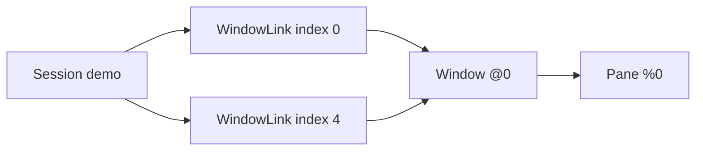

# Capture and navigate a tmux server

[`withServer`](../src/LibTmux/Server.hs) adopts an existing tmux endpoint.
[`capture`](../src/LibTmux/Server.hs) reads it into a detached
[`Snapshot`](../src/LibTmux/Snapshot.hs) that stays usable after the handle
closes. The [README](../README.md) shows the
[complete program](../examples/capture-graph/Main.hs).

Start the [demo server](../README.md) from the README, then run from a
checkout:

```console
$ cabal run --verbose=0 capture-graph -- \
    "$LIBTMUX_DEMO_DIR/s" \
    "$(command -v tmux)"
```

To inspect your own server, pass its socket and tmux executable instead. The
program reads that daemon; it never creates or stops it.

The library needs:

- A trusted absolute socket path.
- A writable pin directory on the socket's filesystem. The default is the
  socket's parent.
- A Linux host; see [installation](installation.md#native-backend-host-requirements).

## Physical entities and appearances

A session links windows at numeric indices. One physical window can appear at
two indices, or in several sessions. A pane belongs to its physical window; a
pane occurrence also keeps the window-link context:



- `windows` and `panes` return each physical entity once.
- `windowLinks` and `paneOccurrences` return every appearance: two each in
  this demo.
- Order: lists by numeric ID; links by session ID, then window index;
  occurrences by link, then pane index. Lookups are indexed.

References:

- A reference names a target within one Server generation. Independent Server
  scopes have distinct generations.
- A lookup returns the observation in the snapshot you pass, including a later
  capture from the same Server.
- `lookupPaneId` picks a native ID's observation in the snapshot you pass. It
  does not restore an earlier targeting guarantee.

Values:

- Record updates make local values. They do not change the snapshot's indexes,
  validate the edited graph or send a command.
- Compare sizes with `dimensionValue pane.width`; dimensions have no
  [`Num`](https://hackage-content.haskell.org/package/base-4.22.0.0/docs/Prelude.html#t:Num)
  instance.
- Paths and command names keep POSIX bytes. Window labels are `TmuxText`;
  converting to text is explicit and can fail.

## Errors and recovery

- Acquisition fails in `IO` with `TmuxException`.
- Pure navigation returns `Either LookupError`. A missing or foreign reference
  is never an empty result.
- A snapshot records a monotonic capture interval. It is not a transaction over
  tmux and operating-system state.

`withServer` rethrows the callback's own exception, cancellation included.

- If bounded cleanup stays incomplete, the exception context holds a
  `CleanupRecovery`.
- After a successful callback, incomplete cleanup raises `CleanupFailed`.

Catch with:

- `tryTmux`: library failures.
- [`Control.Exception.tryWithContext`](https://hackage-content.haskell.org/package/base-4.22.0.0/docs/Control-Exception.html#v:tryWithContext):
  also application exceptions and cancellation.

Both keep the
[`ExceptionWithContext`](https://hackage-content.haskell.org/package/base-4.22.0.0/docs/Control-Exception.html#t:ExceptionWithContext)
that recovery needs. A typed `try` drops it.

`cleanupRecoveries` and `captureRecoveries` read the correlated owners from
that context. For each owner you can:

- Inspect it locally.
- Resume cleanup. This never sends a second capture.
- Detach the uncertainty. This stops no native resource and proves nothing
  about the daemon.

Details: [process contract](contracts/process.md).

## See also

- [Offline fixtures](fixtures.md): test graph logic without tmux.
- [Performance](performance.md): capture cost by graph size.
- [Shared Runtime](shared-runtime.md): independent handle lifetimes.
- [Status](status.md): what is implemented.
