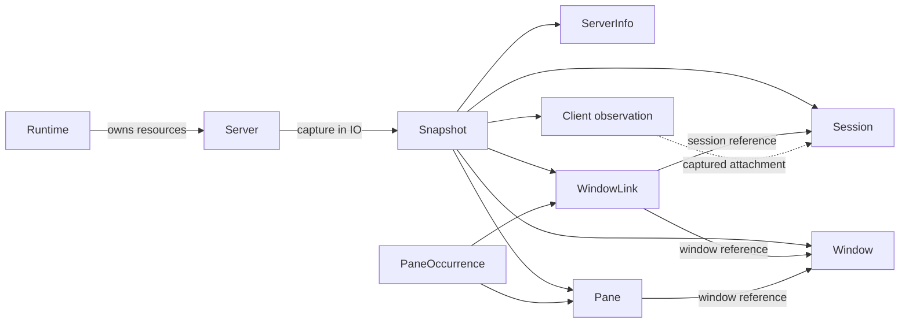

# ADR 0001: Native domain objects, detached snapshots and explicit effects

## Status

Accepted for implementation after the four external reviews and their
[source and probe reconciliation](0001-native-domain-model-qualification.md).
Public API acceptance remains conditional on the qualification work below.
The current exported modules are `LibTmux.Id`, `LibTmux.Value` and
`LibTmux.Version`; [PR #2][capture-pr] contains the private implementation.

## Context

The library needs a recognizable tmux model with Haskell semantics. Reading
captured values is pure; acquisition and mutation are explicit in `IO`.
A window can appear in several sessions and at two indices in one session.
A session-owned tree cannot represent that graph faithfully.

Naming follows inspected functional ports: [Elixir][elixir-entities] uses
physical windows and links; [F#][fsharp-hierarchy] preserves familiar domain
modules; [OCaml][ocaml-interface] and [Common Lisp][lisp-model] distinguish
operational clients from captured data. [Clojure][clojure-data] makes local
traversal explicit. [Python][python-server] supplies recognizable domain
nouns, while [Java's contextual Window][java-window] demonstrates why names
alone do not establish equivalent semantics. These precedents inform the
API; their tests do not establish Haskell support.

This record follows the decision structure used by the [JVM][java-adr],
[F#][fsharp-adr] and [Python][python-adr] repositories. Implementation evidence
and unfinished qualification live in the linked companion, so prototype
counts and budgets do not become permanent API guarantees accidentally.

## Decision

### Use Server for one operational adoption

`Server` is an opaque operational handle to a pinned endpoint and one
connection generation. Acquire it in `IO` from a pure `ServerConfig`.
Closing it releases library-owned resources; killing the daemon is a separate
operation. Reserve `Client` for a detached observation from the attached-client
listing, and `ServerInfo` for observed server metadata. Rename private
operational Client terminology before exposing source-linked public modules.

Use a caller-owned `Runtime` for advanced ownership and recovery. Offer
`withServerIn` for that runtime and a convenient `withServer` after its
failure and recovery contract is qualified. Do not offer Client and Server
as aliases for the same operational type.

### Keep observations detached and the graph relational

`Snapshot` owns a validated graph, capture interval, origin, capabilities and
coverage. `Session`, `Window` and `Pane` are physical observations;
`WindowLink` records a session/index/window binding and its contextual state.
`PaneOccurrence` pairs a physical pane with a link. A pane belongs to one
window; neither has a unique session.



Records hold owned values and references, with no operational handle or
suspended read. Finish fallible decoding and force the required graph normal
form before transferring ownership. Later lazy collection processing remains
safe after closure. Strict fields and [Data.Map.Strict][map-strict] alone do
not establish that boundary; use explicit `NFData` forcing.

Snapshot construction and live-reference constructors remain controlled.
Caller-created or edited observation records are local values: they do not
rewrite snapshot indexes, prove provenance or certify graph validity. Commands
take a Server and an opaque reference. Provide validated offline fixture
descriptions with a detached origin whose references cannot target a live
Server. Decide observation constructor exports through an installed consumer
covering imports, patterns, projections and local updates.

Do not expose reconstruction-capable `Read`, `Generic`, codecs or coercions
that bypass checked-value, reference or Snapshot invariants. `NFData` does not
require a public `Generic` instance. Audit query roles before exporting them.

### Separate targeting identity from capture provenance

A physical reference combines its typed tmux ID, pinned endpoint and fresh
connection generation. Equality means the same target in that scope.
Observation equality compares record contents. Independent handles and
reconnections produce different generations, even against the same daemon.

Lookup resolves the reference in the supplied snapshot if its generation
matches. It may return a newer observation of an older reference. Capture
identity is separate from reference equality. Missing and foreign references
produce `LookupError`, not empty relationships. Re-resolving an ID against a
new generation selects the currently observed entity; it does not restore an
old guarantee. Defer cross-handle comparison and rebinding until a caller
needs an explicitly weaker operation.

A window-link index is a reusable position. `WindowSlot` expresses intent to
operate on the execution-time occupant; an observed triple is not a permanent
link identity. An expected-window mutation requires an execution-time atomic
check or returns `UnsupportedGuarantee`. Attached-client names are reusable
as well: preserve their captured context without inventing lifetime refs.
See [observations][observations] and [contextual commands][pane-commands].

### Use ordinary collections and explicit effects

These signatures describe proposed interfaces, not runnable examples:

```text
withServerIn :: Runtime -> ServerConfig -> (Server -> IO a) -> IO a
capture      :: Server -> IO Snapshot
sessions     :: Snapshot -> [Session]
windows      :: Snapshot -> [Window]
panes        :: Snapshot -> [Pane]
lookupWindow :: Snapshot -> WindowRef -> Either LookupError Window
panesForWindow :: Snapshot -> WindowRef -> Either LookupError [Pane]
runQuery     :: Snapshot -> Query row -> Either QueryError [row]
fetch        :: Server -> Query row -> IO (Either QueryError [row])
exactlyOne   :: [row] -> Either CardinalityError row
```

Keep ordinary list views alongside indexed lookups. Global physical sources
use numeric ID order; links use session/index order and window-local panes
use pane index, then numeric ID. Preserve occurrence multiplicity. Qualify
whether nonempty navigation results improve the installed consumer before
changing the list contract.

Keep `Dimension` checked and without `Num`; native predicates use
`dimensionValue pane.width >= 120`. Query thresholds may be `Integer` even
when command dimensions must be positive. A writable numeric record field
would bypass the invariant despite a hidden constructor. Preserve the
existing accessor; add literal or record-dot conveniences only for a real
consumer need. [Checked values](../values.md) · [Record rules][record-rules]

Use GHC2024, record dot, `DuplicateRecordFields`, `NoFieldSelectors`, GADTs,
newtypes, explicit deriving and ordinary `IO`. Require no custom prelude,
compiler plugin, effect framework or optics library. Installed examples must
qualify selective/qualified imports, duplicate labels and update behavior.
[GHC edition guidance][ghc-editions]

### Define a finite capture profile and each field's encoding

The initial complete Snapshot includes ServerInfo, physical entities, links,
panes and attached-client observations. Unacquired clients cannot become an
empty list. A scoped future capture must declare its coverage. Supported
absence, unavailable capability and failed acquisition remain distinct.
Private topology rows must not masquerade as hydrated observations.

Use one closed typed field catalogue carrying stable identity, format mapping,
wire kind, decoder, capabilities and pure projection. Preserve potentially
non-text window names and current commands with explicit text conversion;
use an explicit POSIX path representation. State upstream normalization for
each field. For example, tmux 3.7+ can report an empty command after rejecting
invalid command-name bytes. No Haskell type can recover discarded data.
Keep one observation hierarchy. Encoding uncertainty stays representable;
malformed framing and invalid graph structure fail complete capture.

Qualify a bounded, tagged, nonce-delimited record envelope before export.
Prioritize reducing read boundaries over parallel per-field hydration.
Backslash preservation and release-specific output decoding are required on
tmux 3.4, 3.5 and 3.5a. Keep context receipts, response bounds, decoded limits,
entity limits, deadlines and inspection reserves. Extra hook output fails.
See [framing](../contracts/framing.md) and [acquisition](../contracts/acquisition.md).

A single expansion can improve consistency of tmux-owned state, but Snapshot
promises an observation interval, not global atomicity. OS-derived callbacks
can observe changing external state. Hooks can run between commands in one
invocation. Qualify the tmux 3.3a client-listing fallback and repeated physical
fields through links. Capture admission must either wait within its deadline
or return an explicit capacity error; it cannot imply unlimited concurrency.
Measure native capture latency and server pauses before qualifying defaults.

### Preserve failure, cancellation and reachable recovery

Closing admission, physical cleanup and logical completion are distinct.
The [lifecycle outcomes](../contracts/process.md#public-scope-outcomes) are
normative for both Server scopes. Preserve the callback exception, including
asynchronous cancellation, when cleanup also fails. Retain secondary cleanup
diagnostics and a reachable recovery owner. Successful callbacks with failed
cleanup report that failure. Recovery-worker allocation failure must leave
existing ownership reachable.

Correlate capture failure with operation ID, endpoint/generation, physical
cleanup state, logical outcome and available recovery or explicit detachment.
A caller must not infer that an operation never ran from cancellation or child
exit. Batching alone does not justify deleting unresolved read responsibility.
Avoid generally blocking uninterruptible cleanup. Exception-context mechanisms
need integrated accepted-read cancellation and double-failure tests.

Operational failures use concrete `TmuxException`; parsing, lookup, query and
cardinality use their respective `Either` results. `tryTmux` catches only
library operational failures. Workers have an explicit wait, link or supervised
failure channel. [Exceptions][exceptions] · [Scoped concurrency][async]

### Keep queries optional and validate before evaluation

Use native predicates for unrestricted local logic. Use a closed `Expr row`
and `Query row` with named combinators for inspection, interchange and plans.
The authoritative field catalogue may include derived fields. Pure projections
do not replace wire identity or prove decoder equivalence.

Validate every field, relationship and evaluator requirement before evaluating
any branch, including empty sources and short-circuit cases. Preflight known
capability failures before unnecessary acquisition. Keep prepared plans private
until a consumer establishes their lifetime assumptions. Relationships preserve
snapshot context and same-child semantics. Known empty relations follow ordinary
quantifier laws; unavailable relations fail validation. Filter interchange has
an explicit compatibility profile. [Typed-query precedent][beam]

## Alternatives and consequences

Operational Client is credible in OCaml and Lisp, but Server leaves Client
available for the tmux domain object. Live entity handles hide acquisition and
couple navigation to resource lifetime. Ordinary predicates remain supported;
they do not replace the required inspectable representation. Rank-scoped and
linear references cannot establish external entity liveness. A Java adapter
needs a concrete consumer and is not the native default.

The public API requires explicit snapshots for navigation and Servers for
commands. In exchange, captured values survive closure and repeated local
queries perform no hidden reads. Native process ownership carries a Linux
maintenance cost. Document glibc 2.39 and required kernel operations for the
initial backend; any alternative launch path needs separate qualification.
[Host contract](../contracts/process.md#launch-and-host-requirements)

Keep only the selected newest stable GHC series and the required exact tmux
3.3a through 3.8 support range, with CI at its endpoints. Keep MCP excluded.
Workspace is a separate Cabal package using
public core APIs, with file-format and CLI dependencies outside the core.
[Package policy](../../.github/CONTRIBUTING.md#package-and-dependency-policy) ·
[Cabal projects][cabal-projects]

Implement private framing, field semantics, complete capture and recovery
first. Before export, qualify installed programs for detached navigation,
typed selection plus mutation, and cancellation/recovery, along with offline
fixtures and measured capture cost. The [qualification record](0001-native-domain-model-qualification.md)
retains open gates. Architectural acceptance does not establish adoption or
release readiness.

## References

[capture-pr]: https://github.com/libtmux/libtmux-haskell/pull/2
[graph-source]: https://github.com/libtmux/libtmux-haskell/blob/a731b95d3a627e42044948d43b86b24277c4708b/internal/LibTmux/Internal/Graph.hs
[capture-source]: https://github.com/libtmux/libtmux-haskell/blob/a731b95d3a627e42044948d43b86b24277c4708b/internal/LibTmux/Internal/Capture.hs
[elixir-server]: https://github.com/libtmux/libtmux-elixir/blob/ca642aa51944952368c413b64ab58bfa0efd5950/lib/libtmux/server.ex
[elixir-entities]: https://github.com/libtmux/libtmux-elixir/blob/ca642aa51944952368c413b64ab58bfa0efd5950/lib/libtmux/entities.ex
[fsharp-hierarchy]: https://github.com/libtmux/libtmux-dotnet/blob/0b15fa94aef31932c5a7be8090928f1b98f32138/src/LibTmux.FSharp/Hierarchy.fsi
[fsharp-values]: https://github.com/libtmux/libtmux-dotnet/blob/0b15fa94aef31932c5a7be8090928f1b98f32138/src/LibTmux.FSharp/Library.fs
[ocaml-interface]: https://github.com/libtmux/libtmux-ocaml/blob/53a51bed2caa198be0fc3d81cb464e29d9f29403/lib/libtmux.mli
[lisp-client]: https://github.com/libtmux/libtmux-lisp/blob/31d90723d8b3f42e9c77778e3fd0e9a99576fe7f/src/client.lisp
[lisp-model]: https://github.com/libtmux/libtmux-lisp/blob/31d90723d8b3f42e9c77778e3fd0e9a99576fe7f/src/model.lisp
[clojure-core]: https://github.com/libtmux/libtmux-java/blob/941f2162062b6d118c68b7d1c23417e0d2cea124/libtmux-clojure/src/main/clojure/libtmux/core.clj
[clojure-data]: https://github.com/libtmux/libtmux-java/blob/941f2162062b6d118c68b7d1c23417e0d2cea124/libtmux-clojure/src/main/clojure/libtmux/data.clj
[python-server]: https://github.com/tmux-python/libtmux/blob/699f72a507ef63d97792acc51e9eaa61649c538a/src/libtmux/server.py
[java-window]: https://github.com/libtmux/libtmux-java/blob/256670be277f4b9db8201dfb782356c31f3a4f30/libtmux/src/main/java/io/github/libtmux/Window.java
[java-adr]: https://github.com/libtmux/libtmux-java/blob/256670be277f4b9db8201dfb782356c31f3a4f30/docs/decisions/0003-hierarchy-hydration-per-entity-listings.md
[fsharp-adr]: https://github.com/libtmux/libtmux-dotnet/blob/0b15fa94aef31932c5a7be8090928f1b98f32138/docs/decisions/0009-fsharp-covers-idioms.md
[python-adr]: https://github.com/tmux-python/libtmux-mcp/blob/d5031596df51de084f45b6f57294225d096092cc/docs/dev/adr/0001-capability-model.md
[observations]: ../contracts/observations.md
[pane-commands]: ../contracts/pane-commands.md
[ghc-editions]: https://downloads.haskell.org/ghc/9.14.1/docs/users_guide/exts/control.html
[record-rules]: https://downloads.haskell.org/ghc/9.14.1/docs/users_guide/exts/duplicate_record_fields.html
[map-strict]: https://hackage-content.haskell.org/package/containers-0.8/docs/Data-Map-Strict.html
[exceptions]: https://hackage-content.haskell.org/package/base-4.22.0.0/docs/Control-Exception.html
[async]: https://hackage-content.haskell.org/package/async-2.2.6/docs/Control-Concurrent-Async.html
[beam]: https://haskell-beam.github.io/beam/user-guide/queries/basic/
[cabal-projects]: https://cabal.readthedocs.io/en/stable/cabal-project-description-file.html#specifying-the-local-packages
