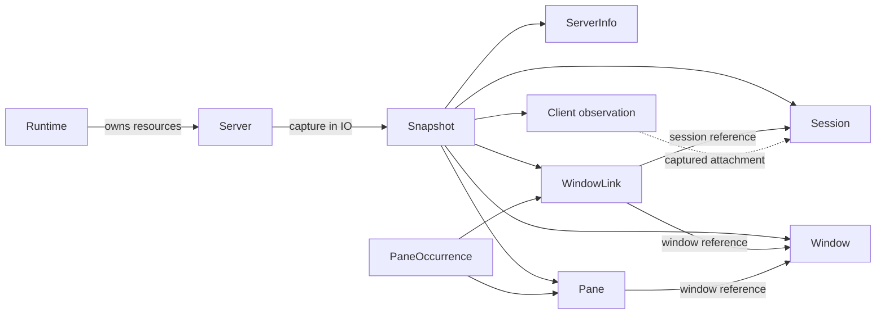

# ADR 0001: Native domain objects, detached snapshots and explicit effects

## Status

**Proposed; awaiting expert review.** This record proposes the public model.
It does not approve implementation or claim that the proposed API exists.
Public entity API work is held for review; the private capture prototype
remains visible in [PR #2][capture-pr].

Reviewed on 2026-11-08 against the [capture prototype][capture-source] and
[graph implementation][graph-source]. The public exports are still
`LibTmux.Id`, `LibTmux.Value` and `LibTmux.Version`.

## Context and problem

The library needs a recognizable tmux domain model with Haskell semantics.
Reading captured data should be pure. Acquiring data and changing tmux should
be visible in `IO`. A window can have several links, including two indices in
one session, so a tree of session-owned windows loses information.

The existing private graph already separates physical entities, window links
and pane occurrences. The proposed public facade has not shipped. This is
the opportunity to settle names, identity, completeness and ownership before
callers depend on them.

The recommendation is a native value model over an explicit operational
handle, with ordinary finite collections and a separate typed query AST.
This is a recommendation for this port, not a claim that Haskell has one
universally preferred application architecture.

## Scope

This decision covers core domain names, graph structure, references, local
queries and effect/resource boundaries. It preserves Linux x86_64, literal
tmux 3.3+, the required exact-release matrix and the current qualified
GHC 9.14.1/GHC2024 toolchain. No older-compiler layer is proposed.

Workspace remains a separate Cabal package using the core. MCP is excluded.
Transport replacement, the full operation catalogue and release readiness
are separate decisions. Existing behavioral contracts remain authoritative
until a reviewed change explicitly supersedes them.

## Naming precedents

These are inspected, revision-pinned interfaces. Their names inform this
proposal; their behavior and passing tests do not establish Haskell support.

| Port | Names and boundaries | Lesson for Haskell |
| --- | --- | --- |
| [Elixir Server][elixir-server] and [entities][elixir-entities] | `Server` describes the endpoint; `Snapshot`, `Session`, physical `Window`, `WindowLink`, `Pane` and captured `Client` separate observed state. | Keep the domain nouns and the physical-window/link distinction. Haskell's operational handle will own resources, unlike Elixir's pure Server descriptor. |
| [F# hierarchy][fsharp-hierarchy] and [captured values][fsharp-values] | Qualified `Server`, `Session`, `Window`, `Pane`, `Snapshot` and `Selection` modules adapt .NET handles; effects return tasks. | Keep familiar module names, but use `IO`, lists and `Either` where they express the Haskell contract. Its contextual windows are not our physical-window model. |
| [OCaml public interface][ocaml-interface] | `Endpoint`, `Source`, `Generation`, `Snapshot`, `Session`, `Window`, `Window_link`, and backend `Client` modules distinguish values from effects. | Preserve explicit provenance and immutable observations. A connection named Client is a credible alternative. |
| [Common Lisp client][lisp-client] and [model][lisp-model] | Operational `client`; captured `snapshot`, `session`, `window`, `pane`, `window-link` and `attached-client`. | Separate an operational connection from an attached tmux client observation. |
| [Clojure effects][clojure-core] and [data][clojure-data] | `open!` returns a Java `Server`; `snapshot!` acquires maps; local traversal and identity/link comparisons live in `libtmux.data`. | Make acquisition explicit and preserve physical identity separately from contextual occurrence. Native Haskell values need no foreign-reference payload. |
| [Python Server][python-server] and [Java Window][java-window] | Server/Session/Window/Pane provide familiar entry points. Java's Window is a contextual link, with an underlying window ID. | Reuse vocabulary, while documenting the semantic difference rather than copying an object hierarchy. |

The record follows the context/decision/alternatives/consequences structure
used by the [JVM ADRs][java-adr] and [F# ADRs][fsharp-adr], with an explicit
proposed status as in this [Python ADR][python-adr].

## Proposed decision

### Name the operational root Server

Expose **`Server`** as the opaque handle for operations against one pinned
tmux endpoint. Construct its pure configuration as `ServerConfig`; acquire
its resources explicitly in `IO`. Closing the handle releases library-owned
resources and never means killing the daemon.

This changes the earlier public proposal's operational name from `Client`
to `Server`. There is no exported Client to migrate. The private
`Runtime.Client` can keep its backend name. Reserve public `Client` for an
immutable tmux client observation, and use `ServerInfo` for captured server
metadata. The client listing's attached-client scope is explicit; it does
not promise every transient command client. Optional attachment is represented
as supported absence, not an invented session.

The reason is domain discoverability: a caller seeking sessions starts at a
Server, while client inspection means tmux clients. The OCaml/Lisp naming
alternative remains valid; critics should assess this choice before export.
Do not offer Server and Client as two names for the same operational type.

### Keep the graph as detached values

| Type | Meaning |
| --- | --- |
| `Runtime` | Explicit owner of worker, child-process and cleanup obligations; advanced lifecycle API. |
| `Server` | Operational handle bound to one connection generation and pinned endpoint. |
| `ServerInfo` | Detached server metadata observed during a recorded interval. |
| `Snapshot` | Validated entity graph, capture interval, origin and capability/coverage metadata. |
| `Session`, `Window`, `Pane` | Immutable physical observations. |
| `WindowLink` | Observed session/index/window binding, including contextual active state. |
| `PaneOccurrence` | A physical pane together with one window-link context. |
| `Client` | One captured tmux client observation; not a permanent client identity. |
| `SessionRef`, `WindowRef`, `PaneRef` | Opaque, generation-bound physical targeting references. |
| `WindowSlot` | Explicit session/index targeting intent; its execution-time occupant can change. |



Snapshot lookup resolves references locally. Records contain data and
references, not an operational Server or a suspended read. A pane has one
physical window; neither has a unique session. Session navigation therefore
offers `windowLinks` and `paneOccurrences` explicitly.

Keep ordinary record types and documented field labels. Application-created
or updated records are local values; they cannot alter the snapshot's indexes
or tmux. Snapshot assembly and reference constructors remain controlled by
validation. Mutation APIs take a Server and an explicit reference, not a
record whose other fields might have been edited.

### State identity and equality precisely

A reference combines the typed tmux ID with the pinned endpoint and a fresh
connection generation. Repeated captures through the same Server can compare
references. Reconnection creates a new generation, even for the same daemon;
references from independent handles are deliberately not interchangeable.
This is connection-scoped targeting identity, not a universal daemon UUID.

Reference equality means the same target in that scope. Observation-record
equality compares fields. A renamed window can retain its reference while
producing a different record. References can outlive a connection as data;
they do not prove that a target still exists or that an operation is allowed.

Window-link indices are reusable positions. An observed
`(session, index, window)` triple does not create a permanent link identifier.
Use an explicitly weaker slot operation when the caller intends the current
occupant. Refuse an expected-window compare-and-mutate guarantee until an
execution-time atomic check is proved. See the [observation contract][observations]
and [contextual command contract][pane-commands].

Attached-client names are also reusable. Store their captured attachment
context and observation identity; do not re-resolve an old name during pure
navigation or mint a strong lifetime reference from it.

### Use native collections and explicit effects

Signature sketches below are proposed interfaces, not runnable examples:

```text
withServerIn :: Runtime -> ServerConfig -> (Server -> IO a) -> IO a
capture      :: Server -> IO Snapshot
sessions     :: Snapshot -> [Session]
windows      :: Snapshot -> [Window]
panes        :: Snapshot -> [Pane]
clients      :: Snapshot -> [Client]
windowLinks  :: Snapshot -> [WindowLink]
panesForWindow :: Snapshot -> WindowRef -> Either LookupError [Pane]
runQuery     :: Snapshot -> Query row -> Either QueryError [row]
fetch        :: Server -> Query row -> IO (Either QueryError [row])
exactlyOne   :: [row] -> Either CardinalityError row
```

Lists support comprehensions, `filter`, `map` and folds without a mandatory
Selection/QuerySet wrapper. Return global physical sources in numeric ID
order; order links by session/index and window-local panes by pane index,
then numeric ID. Preserve occurrence multiplicity. A foreign or missing
reference is a lookup error, not an empty relation.

`fetch` acquires in IO and returns the same query-validation result as
`runQuery`. Operational acquisition failures raise `TmuxException`;
query-validation failures remain `Left QueryError`.

Keep checked IDs, dimensions and indices. The current `Dimension` has no
`Num` instance: ordinary predicates use `dimensionValue pane.width >= 120`.
Do not publish the earlier shorthand `pane.width >= 120` as working code.
Record dot improves reading; it does not make duplicate-label record updates
unambiguous. Require neither overloaded updates nor an optics framework.
See [checked values](../values.md) and the [GHC record rules][record-rules].

`GHC2024`, GADTs, newtypes, explicit deriving and ordinary `IO` provide the
required distinctions. Add extensions for a demonstrated use, not to use
every new compiler feature. Applications can wrap IO in ReaderT or their
chosen effect system. No framework, compiler plugin or custom prelude is
part of the consumer contract. [GHC edition guidance][ghc-editions]

### Validate completeness before publishing a Snapshot

A complete Snapshot has the promised entity sets and baseline field profile,
including attached-client observations. The current private capture acquires
sessions, windows, links and panes only. It must not become a complete public
Snapshot by treating unacquired clients as an empty list.

Use a different type for a future scoped capture, or an explicit unsupported
result. Supported absence is `Maybe`; unavailable capability and unacquired
data are separate states. Query validation checks those requirements before
evaluating predicates, including empty sources and short-circuit branches.

Replace the prototype's empty-name topology placeholders with private numeric
topology row types before exposing capture. A wire topology is not yet a
hydrated observation. This lets the type boundary prevent accidental early
publication without making callers learn another result collection.

Finish external reads, checked decoding and forcing before ownership transfer.
Strict fields and [Data.Map.Strict][map-strict] alone provide only limited
strictness guarantees; explicitly force the required graph normal form.
Later lazy list processing may safely run after closure because it uses
owned values. Preserve paths as bytes; decode declared Text fields strictly,
without replacement characters or implicit normalization.

### Keep lifecycle ownership visible

Use a caller-owned Runtime as the explicit recovery-capable foundation.
`withServerIn` closes its Server scope; failed cleanup remains reachable
through that Runtime. Closing admission, physical cleanup and logical command
completion are distinct observations.

A convenience `withServer` remains a required ergonomic goal, but its cleanup
handoff must be reviewed and tested before export. A plain `bracket` around
the existing private Runtime is insufficient: cleanup can fail while owners
remain, and a secondary failure must not discard callback cancellation.
The convenience form must wait for cleanup or retain a reachable recovery
handle while preserving the primary exception. This ADR does not approve a
specific exception-annotation or background-supervisor implementation.

Likewise, a failed or cancelled capture read can retain logical permits after
physical cleanup. Expose unresolved operation receipts through the owner and
allow an explicit responsibility-detach decision. Do not silently reset them
on a timer or report success. Cancellation during an accepted read, followed
by recovery and another capture, is a required acceptance case.

Operational IO failures use a concrete `TmuxException`; pure parsing, lookup,
query and cardinality failures use their respective `Either` results.
`tryTmux` catches only library operational failures. Preserve asynchronous
exceptions and their context. Workers need an explicit wait, link or supervised
failure channel; merely spawning them with `withAsync` is insufficient.
[Exception semantics][exceptions] · [Scoped concurrency][async]

### Keep the portable query representation small

Ordinary predicates remain unrestricted local Haskell. Use `Expr row` and
`Query row` when a caller needs inspection, interchange or a query plan.
Opaque field/relation descriptors carry row/value types, stable identifiers,
decoding, supported operators and capability metadata. A function-only field
does not supply that portable identity.

Use a closed GADT representation and named combinators. Avoid an Entity type
class hierarchy and arbitrary callbacks inside the portable AST. Keep one
authoritative catalogue for wire mappings and query fields; the prototype's
small Runtime field sum must not become a competing schema.

Relations retain cardinality and snapshot context. Same-child predicates and
independent existential predicates have different meanings. Empty known
relations obey ordinary quantifier laws; unavailable ones fail validation.
Filter interchange declares a compatibility profile, not blanket equivalence
with another port's contextual Window model. [Typed-query precedent][beam]

### Qualify acquisition cost before selecting optimizations

Keep the private one-shot, no-start, pinned transport as the measured
correctness baseline. It avoids attachment during ordinary observation.
The current graph capture uses `2 + S + W + 3P` successful read requests per
attempt for sessions S, unique windows W and unique panes P. It hydrates those
fields serially; server metadata and attached-client acquisition will add work.

That cost does not establish a suitable two-second default for large graphs.
Measure realistic small, medium and linked-window cases before claiming the
deadline or throughput is qualified. Bounded parallel hydration can use the
ordinary read lane; preserve reserved inspection capacity. Batch arbitrary
text only after its framing has an equivalence proof and real-tmux tests.

Two matching topologies establish the documented consistency check, not a
transaction or detection of every intermediate change. Do not promise atomic
scalar observations. Control mode remains an explicit event capability with
its own attachment, overflow and resynchronization contract, not a hidden
capture optimization. See the [framing](../contracts/framing.md),
[socket pin](../contracts/socket-pin.md) and [process](../contracts/process.md)
contracts.

## Alternatives

| Alternative | Decision and consequence |
| --- | --- |
| Call the operational type Client, as OCaml and Lisp do | Credible runner-up. It emphasizes the connection role but needs a distinct name for tmux client observations. Decide before exports; do not maintain aliases. |
| Live entity handles that read during navigation | Reject for the native public model. Detached values make acquisition, lifetime and repeated-query behavior explicit. |
| Arbitrary predicates only | Keep them as the simplest local path, but retain a typed AST for the required portable query/interchange contract. |
| Compulsory effect framework, optics or custom result collection | Reject as core requirements. They add consumer machinery without establishing tmux identity, completeness or external completion. |
| Rank-scoped or linear references everywhere | Do not require them. They complicate detached observations and cannot establish that an external pane still exists. |
| Mandatory Java backend | Reject as the default. The native API owns its data and effects; any future adapter must preserve the same contracts through an explicit boundary. |

## Audit outcome and consequences

The value/IO/physical-link separation is the recommended foundation. Public
API readiness is **unproven**. The following are requirements before export,
not claims of defects in an already shipped Client API:

| Finding | Required action |
| --- | --- |
| Server/Client terminology is not settled | Review this naming proposal and use one operational root. |
| Wire topology uses ordinary entity records with empty text | Separate private topology rows from hydrated observations. |
| Attached clients and public completeness metadata are missing | Complete the declared Snapshot profile before exposing it. |
| Private cleanup can fail with retained owners | Prove reachable recovery and primary-exception preservation. |
| Capture errors can leave unresolved read responsibility | Expose receipts and test repeated failures followed by valid capture. |
| Cancellation coverage currently pauses between reads | Add an oracle for cancellation during an accepted read. |
| Exact-target and non-UTF-8-path acquisition need live oracles | Assert actual target rejection and exact returned path bytes. |
| Per-field process cost and deadline suitability are unmeasured | Benchmark the acquisition plan and bound any concurrency. |
| Public reexports and examples do not exist yet | Qualify actual Haddock interfaces and installed consumers. |

The result is more explicit than a Python-style handle API: relationships
need a snapshot and commands need a Server. That cost buys local reasoning
and detached values. The native process/cleanup implementation also carries
Linux-specific maintenance cost; this record does not hide that cost behind
an idiomatic public facade.

## Implementation sequence after acceptance

1. Resolve naming and lifecycle review findings; update superseded contracts
   explicitly. Keep rejected alternatives and their reasons in this record.
2. Separate wire topology from hydrated records and complete the Snapshot
   profile, identity laws and recovery cases on owned tmux fixtures.
3. Add the public Server/Snapshot modules and installed graph-navigation
   examples. Preserve native Haddock types, field links and source anchors.
4. Add typed query and command consumers, then events and workspace. Keep
   codecs and workspace dependencies outside the core. Use the existing
   [Cabal package policy](../../.github/CONTRIBUTING.md#package-and-dependency-policy)
   and [multi-package project support][cabal-projects].

Each stage needs current-source tests, the required tmux matrix and independent
review. Passing the prototype's present tests does not close the full goal.

## Questions for the expert

1. Is Server the clearest operational root, or does Client's connection meaning
   justify diverging from the Python/JVM/Elixir naming?
2. Are ordinary observation records, opaque references and one validated graph
   the right Haskell boundary, including the checked-Dimension ergonomics?
3. Is connection-scoped reference equality sufficient, or is a separate,
   explicitly weaker cross-handle comparison needed by an actual caller?
4. Does the Runtime/recovery foundation make cleanup responsibility usable
   without imposing it on every successful high-level call?
5. Should strict Text acquisition failure remain the default for invalid UTF-8,
   or should a separate byte-preserving observation profile be designed?
6. Is per-field hydration acceptable as a baseline once measured, and what
   evidence would justify batching or bounded parallelism?

## References

[capture-pr]: https://github.com/libtmux/libtmux-haskell/pull/2
[graph-source]: https://github.com/libtmux/libtmux-haskell/blob/a731b95d3a627e42044948d43b86b24277c4708b/internal/LibTmux/Internal/Graph.hs
[capture-source]: https://github.com/libtmux/libtmux-haskell/blob/a731b95d3a627e42044948d43b86b24277c4708b/internal/LibTmux/Internal/Capture.hs
[elixir-server]: https://github.com/libtmux/libtmux-elixir/blob/ca642aa51944952368c413b64ab58bfa0efd5950/lib/libtmux/server.ex
[elixir-entities]: https://github.com/libtmux/libtmux-elixir/blob/ca642aa51944952368c413b64ab58bfa0efd5950/lib/libtmux/entities.ex
[fsharp-hierarchy]: https://github.com/libtmux/libtmux-dotnet/blob/0b15fa94aef31932c5a7be8090928f1b98f32138/src/LibTmux.FSharp/Hierarchy.fsi
[fsharp-values]: https://github.com/libtmux/libtmux-dotnet/blob/0b15fa94aef31932c5a7be8090928f1b98f32138/src/LibTmux.FSharp/Library.fs
[ocaml-interface]: https://github.com/libtmux/libtmux-ocaml/blob/53a51bed2caa198be0fc3d81cb464e29d9f29403/lib/libtmux.mli
[lisp-client]: https://github.com/libtmux/libtmux-lisp/blob/31d90723d8b3f42e9c77778e3fd0e9a99576fe7f/src/client.lisp
[lisp-model]: https://github.com/libtmux/libtmux-lisp/blob/31d90723d8b3f42e9c77778e3fd0e9a99576fe7f/src/model.lisp
[clojure-core]: https://github.com/libtmux/libtmux-java/blob/941f2162062b6d118c68b7d1c23417e0d2cea124/libtmux-clojure/src/main/clojure/libtmux/core.clj
[clojure-data]: https://github.com/libtmux/libtmux-java/blob/941f2162062b6d118c68b7d1c23417e0d2cea124/libtmux-clojure/src/main/clojure/libtmux/data.clj
[python-server]: https://github.com/tmux-python/libtmux/blob/699f72a507ef63d97792acc51e9eaa61649c538a/src/libtmux/server.py
[java-window]: https://github.com/libtmux/libtmux-java/blob/256670be277f4b9db8201dfb782356c31f3a4f30/libtmux/src/main/java/io/github/libtmux/Window.java
[java-adr]: https://github.com/libtmux/libtmux-java/blob/256670be277f4b9db8201dfb782356c31f3a4f30/docs/decisions/0003-hierarchy-hydration-per-entity-listings.md
[fsharp-adr]: https://github.com/libtmux/libtmux-dotnet/blob/0b15fa94aef31932c5a7be8090928f1b98f32138/docs/decisions/0009-fsharp-covers-idioms.md
[python-adr]: https://github.com/tmux-python/libtmux-mcp/blob/d5031596df51de084f45b6f57294225d096092cc/docs/dev/adr/0001-capability-model.md
[observations]: ../contracts/observations.md
[pane-commands]: ../contracts/pane-commands.md
[ghc-editions]: https://downloads.haskell.org/ghc/9.14.1/docs/users_guide/exts/control.html
[record-rules]: https://downloads.haskell.org/ghc/9.14.1/docs/users_guide/exts/duplicate_record_fields.html
[map-strict]: https://hackage-content.haskell.org/package/containers-0.8/docs/Data-Map-Strict.html
[exceptions]: https://hackage-content.haskell.org/package/base-4.22.0.0/docs/Control-Exception.html
[async]: https://hackage-content.haskell.org/package/async-2.2.6/docs/Control-Concurrent-Async.html
[beam]: https://haskell-beam.github.io/beam/user-guide/queries/basic/
[cabal-projects]: https://cabal.readthedocs.io/en/stable/cabal-project-description-file.html#specifying-the-local-packages
